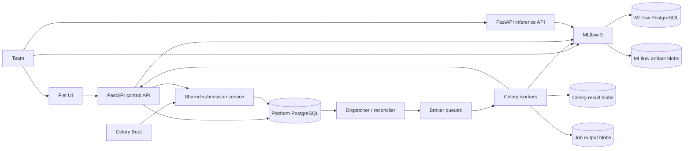

# ml-platform

[Project index](../../README.md) · [Build worksheets](../worksheets/README.md)

A local-first machine learning platform for a small team, centered on MLflow 3, Celery, FastAPI, and a Flet operations UI. Develop and exercise the system with Docker Compose, then deploy the same application images to Azure using Terraform.

This document structures the initial proposal. It describes intended behavior and implementation milestones; the application and infrastructure have not been implemented yet. Azure Service Bus is the preferred cloud broker, subject to the compatibility checks below.

The platform should support ad hoc tasks, batches of tasks, periodic execution, experiment tracking, model registration and promotion, and online inference. Start with a small internal team and CPU workers; job duration, GPU needs, concurrency, budget, and inference latency targets remain open sizing inputs.

The proposed “servers” are logical service boundaries. Durable data lives outside application containers. Keeping a service responsive is a separate decision from preserving its data.

| Original grouping | Service | Responsibility | Initial cloud behavior |
| --- | --- | --- | --- |
| A | MLflow 3 | Experiment tracking, model registry, artifact access | Keep one replica warm |
| A | PostgreSQL and Blob Storage | MLflow metadata and artifacts | Managed durable services |
| B | FastAPI control API | Submit jobs, query history, manage schedules, coordinate registry operations | Keep one replica warm |
| B | Flet web UI | Job lists, filters, batch summaries, schedule health, links to MLflow | Keep one replica warm initially |
| B | Celery Beat | Determine when scheduled work is due | One active scheduler, always running |
| B | Dispatch/reconciliation process | Publish pending submissions and repair stale job status | Small continuously running process |
| C | Celery worker pools | Execute registered task code | Queue-driven replicas; scale to zero after interruption behavior is validated |
| D | FastAPI inference API | Load a selected model and serve predictions | Keep one replica warm during required availability hours |

MLflow documents an Azure deployment using Container Apps, PostgreSQL Flexible Server, and Blob Storage, matching the proposed Server A components. [MLflow Azure deployment](https://www.mlflow.org/docs/latest/self-hosting/deploy-to-cloud/azure/)



Use one PostgreSQL instance initially with separate `mlflow` and `platform` databases and separate application credentials. Keep separate Blob containers for MLflow artifacts, Celery results, and job outputs. This separates their retention policies and access permissions without requiring a separate storage account for every purpose.

MLflow owns experiment and model-registry records. The control API owns the team's registration and promotion workflow and calls MLflow's API; it does not implement another registry or write directly into MLflow tables. Workers log training runs and artifacts and report the resulting run/model identifiers. The control API can then register or promote the selected model. MLflow supports model versions and mutable aliases such as `champion`. [Model registry](https://mlflow.org/docs/latest/ml/model-registry)

For initial artifact access, configure MLflow to proxy artifact uploads and downloads to Blob Storage. Workers use the tracking server for MLflow artifacts and access job-output/result containers separately. This choice keeps MLflow artifact credentials at the server, at the cost of passing artifact traffic through it. [Tracking server](https://mlflow.org/docs/latest/self-hosting/architecture/tracking-server/), [Azure artifact storage](https://mlflow.org/docs/latest/self-hosting/architecture/artifact-store/)

The control API is the job-management API. Celery's result backend is a separate storage adapter used by Celery; it is not a FastAPI server. The proposed `azureblockblob` backend is supported and stores task result metadata in Blob Storage. Keep return values small: identifiers, summaries, and output URIs. [Celery Azure Blob backend](https://docs.celeryq.dev/en/v5.6.0/_modules/celery/backends/azureblockblob.html)

The UI should query platform PostgreSQL through FastAPI for job lists, status counts, batch progress, and periodic-job history. Do not derive the job catalog by scanning result blobs. A Celery `PENDING` result alone does not establish that a submitted job is waiting in a queue; unknown task IDs also have that state. [Celery task states](https://docs.celeryq.dev/en/stable/userguide/tasks.html#pending)

Include a minimal Flet dashboard in the first local milestone so the team can see the submission-to-result workflow immediately. Its initial scope is one page:

| Element | Initial behavior |
| --- | --- |
| Jobs table | Job ID, task name, status, queue, submitted time, duration, and MLflow run link when available. Show jobs submitted or completed in the last 24 hours, plus all still-active jobs; newest submissions first, with pagination. |
| Aggregated status counts | Current submitted/queued/running counts across all active jobs, and succeeded/failed counts for jobs completed in the last 24 hours. Label the active backlog and 24-hour outcomes separately. |
| Outcome histogram | Stacked bars for successes and failures in 24 consecutive one-hour buckets covering the rolling last 24 hours, including empty buckets. Assign outcomes by completion time. Add other terminal outcomes when implemented. |
| Refresh | Poll FastAPI every five seconds, offer manual refresh, and display the last successful update time. Show a fetch error as stale/unavailable data, not zero jobs. |

Use a shared server-generated window end for each dashboard refresh. Store and aggregate timestamps in UTC, display the chosen timezone, and label the chart's exact time range. Count logical jobs rather than individual retry attempts; a job that retries and eventually succeeds contributes one success. Active jobs appear in the table and counts but not in the completion histogram. API aggregation operates over the full matching dataset, independently of table pagination.

The milestone demo should include a successful training job linked to MLflow, an intentionally failing task, and a slow task so queued/running states are visible. Validate counts and hourly placement with deterministic timestamped fixtures, including empty buckets and the window boundary. The expanded schedule, batch, and registry-management views remain in milestone 4.

Suggested platform records are `jobs`, `job_attempts`, `batches`, `schedules`, `schedule_occurrences`, and `outbox`. Record submission origin, parameters or input URIs, task/schema version, queue, timestamps, current status, attempt ownership and heartbeat, output references, and MLflow identifiers. A batch groups jobs and aggregates their outcomes. A schedule is a recurring definition; each occurrence creates a separate job.

The initial job lifecycle is `SUBMITTED → QUEUED → RUNNING → SUCCEEDED / FAILED`, with `RETRYING` and `INTERRUPTED` where needed. `SUBMITTED` means the request is stored durably; `QUEUED` means publication was confirmed. Transitions must tolerate a worker starting before the publisher records confirmation, so a late confirmation cannot overwrite `RUNNING` or a terminal status.

The intended submission flow is:

1. FastAPI validates an allowlisted task type and input schema.
2. A database transaction creates the job and an outbox entry, then the API returns a job ID with HTTP 202.
3. The dispatcher publishes a Celery message containing the job ID and compact input references, retrying publication when necessary.
4. A worker claims an attempt through authenticated internal API endpoints, records progress and heartbeats, runs the task, and writes durable outputs.
5. The worker reports its outcome; the API stores job history and links to outputs and MLflow.
6. Reconciliation detects stale attempts and incomplete reporting, using persisted outputs/results and the retry policy to decide the next step.

The outbox is a database list of messages waiting to be sent. It closes the failure gap between saving a job and publishing it. It can still publish duplicates after a crash, so workers must make repeat delivery safe. Use attempt tokens to reject stale updates, unique keys for logical effects, and attempt-specific output paths followed by an atomic choice of the accepted output. Do not claim exactly-once execution.

Start with `default` for short/general tasks and `training` for resource-intensive tasks. Route task types to queues in code; allow only workers with the appropriate image and resources to consume each queue. Ad hoc and periodic jobs can share a queue when they need the same resources. Add a GPU pool only when actual workloads require it. Keep task implementations in worker images and shared task contracts in a lightweight package the API can import.

Celery workers normally run continuously and consume multiple messages, so deploy them as Azure Container Apps with queue scaling. Azure Container Apps Jobs suit containers that do finite work and then exit; an ordinary `celery worker` process does not have that lifecycle. [Container Apps versus Jobs](https://learn.microsoft.com/en-us/azure/container-apps/jobs)

Azure uses KEDA to scale Container Apps from queue metrics, including Service Bus. Set replica limits and worker concurrency together; queue depth alone is not a reliable count of work already executing. Exercise scale-in, deployments, shutdown grace periods, and interrupted-task recovery before enabling zero replicas for training workers. [Container Apps scaling](https://learn.microsoft.com/en-us/azure/container-apps/scale-app)

Celery Beat belongs to the same codebase and deployment group as the control API, but runs in a separate process/container. Running Beat inside every API replica would create multiple schedulers. Celery requires a single active scheduler for a schedule, and its default persistent scheduler stores state in a local file. [Periodic tasks](https://docs.celeryq.dev/en/latest/userguide/periodic-tasks.html), [Beat configuration](https://docs.celeryq.dev/en/stable/userguide/configuration.html#beat-scheduler)

The target is a PostgreSQL-backed Beat scheduler, selected or implemented after a focused evaluation; FastAPI plus Celery does not provide one automatically. Store schedule definitions, next-due information, and occurrence records durably. Use a PostgreSQL lock/lease to ensure one active scheduler even during overlapping deployments. Generate each occurrence and its outbox entry transactionally using a unique `(schedule_id, scheduled_for)` key. Both Beat and the API call the same submission service. Beat can remain lightweight because it only schedules and submits work.

Define schedule timezone, overlap behavior, and missed-run behavior explicitly. Initial proposal: persist UTC timestamps, display the configured timezone, prevent overlapping training runs by default, and coalesce missed occurrences into one run after downtime. Record skipped/coalesced occurrences so the UI can distinguish scheduler health from execution health. These are proposed policies, not guarantees supplied by Beat.

The inference API loads the chosen model once during startup and reports readiness only after loading and a smoke prediction succeed. The deployment records an immutable model version, even if selection begins with an alias. Promotion changes the registry selection and triggers an explicit serving rollout or reload; changing an alias alone does not replace a model already loaded into memory. Preserve the prior version for rollback. [MLflow model loading and aliases](https://www.mlflow.org/docs/latest/ml/model-registry/workflow/)

Keep inference warm while responsiveness matters. Outside those hours, optionally allow scale-to-zero and accept cold-start plus model-loading latency. Scheduled warm-up must finish before the required service window. Keep request schemas, model dependencies, and serving images versioned together.

The local-first workflow has three levels:

| Level | Components | What it establishes |
| --- | --- | --- |
| Unit tests | Plain Python job logic and service code | Validation, job behavior, schedule rules, repeat-delivery behavior |
| Local integration | Docker Compose: API, UI, Beat, dispatcher, workers, inference, MLflow, PostgreSQL, RabbitMQ, Azurite | End-to-end application behavior with real containers and durable local volumes |
| Azure integration | Same application images with Service Bus, Blob Storage, managed identities, and Container Apps | Transport behavior, Azure permissions/networking, and actual scaling |

Azurite provides local Azure Blob emulation, including custom local endpoints. Configure and test both MLflow and Celery against it. Azurite Queue Storage is a different service from Azure Service Bus. [Azurite documentation](https://learn.microsoft.com/en-us/azure/storage/common/storage-use-azurite)

RabbitMQ is the proposed everyday local broker. Passing local tests proves application behavior, not Service Bus equivalence. Microsoft also provides a Service Bus emulator, but treat its use with Kombu as a separate compatibility experiment. Current Microsoft guidance says emulator administration-client support is native only in .NET, while Kombu's transport uses Python management operations and namespace handling. Do not promise a drop-in emulator configuration before testing the exact versions. [Service Bus emulator setup](https://learn.microsoft.com/en-in/azure/service-bus-messaging/test-locally-with-service-bus-emulator), [Kombu transport source](https://docs.celeryq.dev/projects/kombu/en/latest/_modules/kombu/transport/azureservicebus.html)

The Azure Service Bus decision has an explicit gate: pin Celery, Kombu, and Azure SDK versions, then test routing to both queues, retries, worker death, redelivery, managed identity, result retrieval, and a task exceeding five minutes. Service Bus message locks have a maximum single duration of five minutes and need renewal for longer processing. Confirm renewal for the pinned transport rather than assuming an Azure SDK feature is wired into Celery. [Message locks](https://learn.microsoft.com/en-us/azure/service-bus-messaging/message-transfers-locks-settlement)

For interruption recovery, evaluate late acknowledgements and `task_reject_on_worker_lost` together with idempotent tasks and bounded retries. Early acknowledgement can lose in-flight work when a worker disappears; late acknowledgement alone does not handle every worker-process failure. Dead-letter handling and reconciliation must prevent endless failure loops. [Celery acknowledgement behavior](https://docs.celeryq.dev/en/stable/userguide/tasks.html)

Kombu documents Service Bus queue-management permissions as well as messaging permissions. Verify managed-identity roles for the actual transport and scaler separately; precreating queues with Terraform does not by itself remove runtime management calls. Also validate event monitoring and remote control before relying on Flower, worker inspection, or revoke-based cancellation. Keep the platform UI based on explicit job records. [Kombu Service Bus transport](https://docs.celeryq.dev/projects/kombu/en/v5.5.2/reference/kombu.transport.azureservicebus.html)

If the Service Bus checks fail, retain the application contracts and revisit the broker or worker execution mechanism before building more platform features. Long-term result retention should use explicit Blob lifecycle policies; job history remains independently queryable in PostgreSQL.

For Azure, Terraform should describe a resource group, Container Apps environment, application containers, Container Registry, PostgreSQL Flexible Server, Storage account/containers, Service Bus namespace/queues, identities and roles, secrets, networking, logs, and scaling rules. A resource group organizes related resources. Container Registry stores built images. A Container Apps environment provides their shared hosting context. Managed identities let applications authenticate to Azure services without embedding account keys; roles define what those identities may do.

Before team deployment, configure authenticated UI/API access and authenticated programmatic access to MLflow, internal worker reporting, backups, and correlated logs using job and run IDs. Keep durable services outside ephemeral containers. Avoid exposing database or broker administration endpoints publicly. These belong in the deployment configuration, with local development configuration kept separate.

Terraform declares the desired resources; `plan` previews changes and `apply` makes them. Its state maps configuration to deployed resources. Use a separately bootstrapped Azure Blob backend with locking and distinct development/production state, and keep state and secrets out of Git. [Terraform Azure state backend](https://developer.hashicorp.com/terraform/language/backend/azurerm)

Teach the deployment incrementally: build an image locally, push it to Container Registry, deploy one API, connect it to storage using an identity, then add the broker and worker scaling. CI should test code and build images; Terraform should provision/configure infrastructure. Pin dependencies, container images, and Terraform providers when the implementation begins.

Initial repository layout, to create during implementation. Keep one installable Python package with separate process entry points; extract packages later if dependency isolation warrants it. The first worksheet specifies its module files in detail.

```text
src/ml_platform/        # contracts, job logic, API, worker, publisher, tracking, UI
                        # later: Beat/reconciliation and inference entry points
migrations/             # platform database migrations
docker/                 # images and local initialization
compose.yaml            # daily local integration environment
compose.test.yaml       # isolated local test stack overrides
infra/terraform/        # bootstrap and per-environment infrastructure
tests/                  # unit, local integration, Azure integration
docs/specs/             # architecture and milestone sequence
docs/worksheets/        # modular build instructions and learning records
```

Build milestones:

1. **Local vertical slice with a minimal dashboard:** Submit one training job, execute it with Celery, log an MLflow run/model, persist outputs, and observe it in Flet through a jobs table, aggregated status counts, and a 24-hour outcome histogram. Include success, failure, and slow-task demos. Restart containers and verify durable data survives. Confirm the task code can also run directly in a unit test and validate dashboard aggregation.
2. **Azure transport experiment:** Exercise the Service Bus compatibility gate with a minimal worker before committing the platform to that transport.
3. **Durable orchestration:** Harden the basic outbox introduced in milestone 1, add attempt ownership and failure recovery, and implement durable Beat scheduling and batch aggregation. Test broker outage, scheduler restart, duplicate delivery, and worker termination.
4. **Expanded team workflows:** Extend the existing Flet dashboard with schedule and batch views, add registry operations, and add one inference endpoint with explicit model rollout and rollback.
5. **Terraform development deployment:** Provision the Azure environment, deploy tested images, establish identities/access, and validate queue-driven scale-out and scale-in.
6. **Operational readiness:** Rehearse restore and redeployment, set log/result retention and cost alerts, measure latency and throughput, and choose production sizing from those measurements.

The first deliverable is a reproducible local training-to-tracking workflow with an immediately usable operations dashboard. Cloud scaling follows demonstrated task recovery, and always-warm capacity follows measured responsiveness needs.

Work through [milestone 1's worksheet](../worksheets/milestone-01/README.md) one module at a time. Its initial outbox demonstrates durable submission and publication; the full attempt/recovery behavior described above remains the milestone 3 target.
