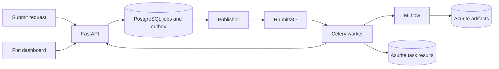

# Milestone 1 — Run a local job and watch it in the dashboard

[Worksheet sequence](../README.md) · [Architecture spec](../../specs/README.md)

You will submit a small training job through FastAPI, watch a Celery worker execute it, open the resulting experiment in MLflow, and see the job in a Flet dashboard. The dashboard starts with a table, status counts, and hourly success/failure bars covering the last 24 hours. A deliberately failing job and a slow job make the other states visible.

The first action is to create a plain Python training function and test it without any services. Each subsequent module introduces one boundary around that function. By the end, you should be able to follow one job ID through the API, database, broker, worker, artifacts, and dashboard and explain what each component contributes.

This is a worksheet, not a generated application. The files, signatures, commands, and tests below are the implementation target. Function bodies are deliberately incomplete. Use regular Python files and the terminal; no notebook is required. Work on one module with your assistant, get its tests passing, and record the result before moving to the next.

You need Python experience, basic model fitting/evaluation, Git, a Python environment manager, and Docker Compose. Use Python 3.12 as the starting candidate and `uv` for the commands below; verify library compatibility during setup and record the selected versions. No Azure account, credentials, GPU, or paid service is needed. Initial package and image downloads require network access; the toy dataset is generated locally. This is several work sessions, with a stopping point after every module.

The scope is local submission, execution, persistence, tracking, and visibility. Persistent periodic scheduling belongs to milestone 3; model promotion and online serving belong to milestone 4. This milestone exposes simple publication failures but does not yet recover a worker killed halfway through training. Those limits are part of the learning record.

Imagine submitting this request:

```json
{
  "task_type": "train_regression",
  "parameters": {"seed": 7, "n_samples": 200, "n_features": 4, "alpha": 1.0}
}
```

The API returns HTTP 202 with a job ID and status `SUBMITTED`. That means the request is stored, not that training is finished. A publisher sends a small message to RabbitMQ. A worker receives the job ID, loads the recorded request, and begins training. The API records `RUNNING`, then `SUCCEEDED` with a completion time, output references, and an MLflow run ID. The dashboard obtains its rows and counts from the API.



A **broker** holds messages until workers receive them. A **worker** is a separate process that executes task code. The API sends the task's name and arguments, not its Python source; the worker image must contain that implementation. Celery's **result backend** holds the task's return value and execution metadata. Our PostgreSQL job record is the catalog used by the dashboard. These are different responsibilities even when they describe the same job.

An **outbox** is a database table of messages waiting to be published. A database **transaction** saves the job and its outbox entry together, or saves neither. This avoids accepting a job and forgetting that it needs to be sent. Sending to RabbitMQ is still separate from that transaction, so a crash can cause a message to be sent twice. This milestone introduces that boundary; milestone 3 adds the full recovery policy.

An **artifact** is a persisted file, such as a model or predictions. Azurite emulates Azure Blob Storage locally. MLflow manages experiment metadata in its own PostgreSQL database and model artifacts through its artifact store. The worker's Celery result contains only small identifiers and summaries. A **migration** is a versioned database schema change that another checkout can apply in the same order.

Use one installable Python package for this milestone, with modules matching the service boundaries. This is the concrete initial layout; extracting separate packages can wait until there is a reason. Each process gets its own entry point even when it shares a source tree or image.

```text
pyproject.toml
uv.lock
.env.example
compose.yaml
compose.test.yaml           # created in G for the isolated test stack
src/ml_platform/
    __init__.py
    contracts.py           # request/result types and allowed task names
    jobs.py                # plain training, failure, and slow-task functions
    state.py               # legal job state transitions
    store.py               # PostgreSQL operations and transactions
    api.py                 # FastAPI routes and dependency wiring
    publisher.py           # outbox -> Celery publication
    worker.py              # Celery app and thin task wrapper
    tracking.py            # MLflow run and artifact integration
    dashboard.py           # counts, time buckets, response types
    ui.py                  # Flet page and API polling
    demo.py                # submit and inspect local demo jobs
migrations/                # Alembic configuration and revisions
docker/                    # application image, service initialization
tests/
    unit/                  # no running infrastructure required
    integration/           # real PostgreSQL, RabbitMQ, MLflow, Azurite
    e2e/                   # complete stack through public interfaces
    host/                  # G's harness that starts/stops the isolated test stack
docs/worksheets/milestone-01/NOTES.md   # your results as you work
```

The seven modules are A: plain jobs; B: persisted job state; C: submission API; D: queue and worker; E: tracking and artifacts; F: dashboard; G: complete local exercise. Each has a test checkpoint below. Do not create later modules merely to make an earlier test import succeed.

**A. Run the task as a Python function.**

Create `pyproject.toml`, an installable `src/ml_platform` package, and `tests/unit`. Add dependencies as their modules need them and commit the lockfile. Initially use pytest, NumPy, and scikit-learn, with validated request types added here or in C. Avoid importing Celery or MLflow from the plain job implementation.

Use generated regression data with a fixed seed, a reproducible 80/20 train/test split, and a Ridge regressor. Return the fitted model, held-out predictions, and mean squared error (MSE). MSE is the average squared prediction error on held-out targets. Do not train on the held-out data. Input limits are `20 <= n_samples <= 10000`, `1 <= n_features <= 32`, `0 <= seed <= 2**32 - 1`, and finite `alpha >= 0`. These bounds keep the demo small and its validation explicit.

Create `TrainingRequest` with the four fields in the example and `TrainingResult` with model, predictions, targets, and MSE. The in-process result can hold arrays and a model; later the worker converts it into references that can be serialized as JSON.

```python
def train_regression(request: TrainingRequest) -> TrainingResult:
    """Generate data, split, fit Ridge, and evaluate on the held-out split."""
    ...

def fail_demo() -> None:
    """Raise a known DemoFailure with a fixed, non-sensitive message."""
    ...

def slow_demo(seconds: float) -> dict[str, float]:
    """Wait 0–30 seconds, then return the requested duration; reject other values."""
    ...
```

1. Write a failing test for invalid input and implement validation.
2. Generate the data and split with an explicit seed. Inspect their shapes.
3. Fit and evaluate the model. Write a test that independently recomputes MSE from returned predictions and targets.
4. Add the failure and slow functions. Inject or mock the waiting operation in unit tests so the suite does not actually wait 30 seconds.

The checkpoint is `uv run pytest tests/unit/test_jobs.py -q`. Tests must cover invalid dimensions, non-finite alpha, reproducibility within the locked environment, a nonempty held-out split, prediction shape, finite/nonnegative MSE, the expected failure type, and the slow-task bounds. Compare arrays with tolerances; a hardcoded cross-version model score is not required.

Explain why this function can be tested without a broker. Record its seed, held-out count, and one observed MSE in `NOTES.md`.

**B. Persist a job and enforce its state changes.**

Add PostgreSQL to Compose with a named volume, then add SQLAlchemy, a PostgreSQL driver, and Alembic to the project. A named volume preserves data when the container is replaced. Configure separate `platform` and `platform_test` databases; only test fixtures may reset the latter. Record the test database check in code so a typo cannot silently clear the development database.

The first migration creates `jobs` and `outbox`. Use server-side UTC timestamps with timezone-aware columns, UUID identifiers, and constraints for allowed status values. `jobs` needs task type, validated parameters, queue, submitted/started/finished times, status, error summary, output references, and nullable MLflow run ID. `outbox` needs its own ID, job ID, publication time, and last publication error. Initially allow one outbox entry per job; repeated publication uses the same Celery task ID, set to the job ID.

`SUBMITTED → QUEUED → RUNNING → SUCCEEDED / FAILED` is the ordinary sequence. Allow `SUBMITTED → RUNNING`: the worker can receive a published message before the publisher records confirmation. A late `QUEUED` update must not undo `RUNNING` or completion. Duplicate reports of the same outcome are no-ops; conflicting terminal reports are rejected. An atomic claim allows only one caller to change a submitted/queued job to running. This is initial duplicate protection, not an expiring attempt lease.

```python
def submit_job(request: JobRequest) -> Job:
    """Commit a new SUBMITTED job and its outbox row in one transaction."""
    ...

def claim_job(job_id: UUID) -> Job | None:
    """Atomically start an eligible job; return None if already claimed/terminal."""
    ...

def finish_job(job_id: UUID, outcome: JobOutcome) -> Job:
    """Persist terminal state and references together; reject conflicting outcomes."""
    ...
```

`JobRequest` contains the task type and validated parameters; queue selection is server-owned. `JobOutcome` contains `SUCCEEDED` or `FAILED`, result references, optional run ID, and an error summary for failure. Define the corresponding response types yourself. Functions above describe the service interface; inject database sessions rather than hiding a global connection inside every function.

1. Draw the allowed transitions and write `state.py` tests.
2. Implement the migration and apply it to an empty test database.
3. Save a request and retrieve it using a fresh connection.
4. Force an exception between inserting a job and inserting its outbox row; assert neither remains after rollback.
5. Test two concurrent claims, duplicate completion, conflicting completion, and late publication confirmation using PostgreSQL.

Run `docker compose up -d postgres`, then `uv run pytest tests/unit/test_state.py tests/integration/test_store.py -q`. The integration fixture applies migrations to `platform_test` and starts from isolated test data. Tests must show all-or-nothing submission, exactly one successful concurrent claim, terminal-state protection, and persistence across fresh sessions. Retain A's passing tests.

Record the SQL or ORM operation that makes the claim atomic. Explain what a container restart preserves and what remains in process memory.

**C. Submit and inspect jobs through FastAPI.**

Add FastAPI, Uvicorn, and HTTPX. Use a `create_app(settings)` factory and injectable store dependencies so tests select the test database. Define an allowlist of the three task types; accepting arbitrary import paths from callers is not part of this API.

| Route | Behavior |
| --- | --- |
| `POST /jobs` | Validate the task-specific parameters, store job plus outbox, and return HTTP 202 with job ID and `SUBMITTED` |
| `GET /jobs/{job_id}` | Return the stored record; HTTP 404 for an unknown ID |
| `POST /internal/jobs/{job_id}/claim` | Return the claimed request, or HTTP 409 if it is already running/terminal |
| `POST /internal/jobs/{job_id}/complete` | Accept a validated outcome; repeat matching reports safely and reject conflicts |
| `GET /health/live` | Confirm the API process responds |
| `GET /health/ready` | Confirm it can access its database; HTTP 503 if unavailable |

Protect internal reporting with a local worker token configured in `.env`, omitted from Git, and represented by a placeholder in `.env.example`. Use a header so the token does not enter URLs. This local credential is not the eventual team authentication design. Bind host-facing local ports to loopback.

1. Write request-validation tests, including unknown tasks and invalid parameters.
2. Implement submission using B's service, with no direct training call inside the HTTP handler.
3. Implement lookup, internal reports, and health routes.
4. Test database unavailability: the API must not return an accepted job when its transaction failed.

Run `uv run pytest tests/integration/test_api.py -q`. Use FastAPI's TestClient against the real test database. Assert HTTP status codes and saved records, that malformed submissions save nothing, that internal reports require the token, and that an unknown ID returns 404 rather than Celery's ambiguous pending state. FastAPI documents its pytest/TestClient integration in [Testing](https://fastapi.tiangolo.com/tutorial/testing/).

At this checkpoint, requests remain submitted because no publisher or worker exists yet. That is observable and expected. Explain why HTTP 202 is different from a successful training result.

**D. Send the job to a separate worker.**

Add RabbitMQ with a named volume, Celery, and two worker services: `worker-default` consumes `default`; `worker-training` consumes `training`. Start each with concurrency one so the sequence is easy to inspect. Route `train_regression` to `training` and the two demo tasks to `default`. Use JSON task messages containing the job ID and a fixed registered Celery task name. Do not serialize the model into a message.

Add a single publisher process that reads unpublished outbox entries, sends a task, and records publication confirmation. Use durable queues/messages and RabbitMQ publisher confirmation for the selected versions. When publication fails, retain the entry and record the error for another pass. When recording success, update the outbox row and the eligible job's `QUEUED` status in one transaction without moving a running/terminal job backward. A repeated Celery task ID is a correlation identifier, not automatic deduplication.

The worker calls C's internal claim endpoint. If the job is already running or terminal, it does no work. On an accepted claim, it dispatches the allowlisted plain function and reports its outcome. A known task exception produces a failed job and is re-raised so Celery also records failure. Errors contacting the reporting API must be visible in logs; do not report success locally as proof that PostgreSQL was updated.

```python
def publish_once(*, limit: int = 10) -> int:
    """Publish pending outbox entries; return the number confirmed this pass."""
    ...

def execute_job(job_id: str) -> dict:
    """Celery wrapper: claim, call the plain job, report, return a small summary."""
    ...
```

1. Write a publisher unit test with a sender that fails. Check that the outbox remains unpublished.
2. Publish one real message and inspect the selected queue with its worker stopped.
3. Start that worker and observe `RUNNING`, followed by a terminal state.
4. Execute the same job message twice; assert the guarded claim permits only one execution while the API/database remain available.
5. Stop RabbitMQ before submitting a new job. Confirm HTTP 202 still returns after saving the job, then restart RabbitMQ and verify the publisher eventually sends it.

For this module, disable task-result storage and expose the small function result through the job report. E enables the intended Blob result backend. Keep automatic application retries and expired-claim recovery out of this checkpoint: a killed worker may leave a job running. Record that behavior for milestone 3 rather than treating the local demonstration as durable execution.

Run `uv run pytest tests/unit/test_publisher.py tests/integration/test_execution.py -q` after starting `postgres`, `rabbitmq`, `api`, `publisher`, and the workers. The integration harness must target the test database and distinct test queue prefixes for every process; no test should publish into a worker connected to the development database. Tests use bounded polling with useful timeout diagnostics rather than fixed long sleeps.

Assert queue routing, success, intentional failure, duplicate-claim behavior, and publication after broker recovery. Use a real Celery worker for these checks. Celery's eager mode executes tasks locally and does not establish real worker/broker behavior. [Celery testing](https://docs.celeryq.dev/en/stable/userguide/testing.html)

Draw the two writes around publication and identify the crash point that could publish twice. Explain why a queued message is different from a job currently executing.

**E. Persist the experiment, model, and task result.**

Add Azurite and MLflow 3. Configure MLflow's metadata in a separate `mlflow` database and its proxied artifacts in an Azurite container. Add a repeatable initialization step for databases and Blob containers. Test runs use `mlflow_test` and dedicated containers or prefixes. Persist PostgreSQL and Azurite data in named volumes.

Create three storage areas: `mlflow-artifacts`, `celery-results`, and `job-outputs`. MLflow writes its model artifacts through its server; the worker writes a small evaluation JSON file to job outputs and uses Celery's `azureblockblob` adapter for task results. A worker's return value contains `job_id`, `mlflow_run_id`, model/output URIs, and metrics. It does not contain a fitted estimator or prediction array.

```python
def run_tracked_training(job_id: str, request: TrainingRequest) -> JobOutcome:
    """Run the plain training function inside an MLflow run; persist references."""
    ...
```

1. Verify an Azure Blob SDK upload/download against Azurite before involving MLflow or Celery. Explicitly configure the endpoint reachable from containers; `localhost` inside a worker refers to that worker.
2. Start MLflow with PostgreSQL and proxied Blob artifacts. Log and retrieve one text artifact to establish that path independently.
3. Wrap A's training function in an MLflow run. Log inputs, MSE, the job ID tag, dependency/code version information, and the model with its input signature. Preserve the resulting model URI using the installed MLflow API instead of guessing its format.
4. Upload the evaluation summary and report its URI, run ID, and model URI to the control API. Persist these with terminal job status.
5. Enable `azureblockblob` task results and read a completed result using a fresh backend client.

Run `uv run pytest tests/integration/test_tracking.py -q`. Assert that the referenced run exists, its job tag and parameters match, its MSE agrees with the returned metric, and the saved model can be loaded in a fresh process to reproduce predictions within tolerance. Assert that the evaluation JSON and Celery result can be retrieved independently. Add an upload-failure case: the platform must not mark the job successful before its required artifacts are durable.

Artifact writing and job completion are separate operations. This milestone does not repair every crash between them; log the run ID early enough to investigate. The successful-flow test establishes retrieval and persistence, not general failure recovery.

Use the public [MLflow tracking server](https://mlflow.org/docs/latest/self-hosting/architecture/tracking-server/), [artifact store](https://mlflow.org/docs/latest/self-hosting/architecture/artifact-store/), [Azurite](https://learn.microsoft.com/en-us/azure/storage/common/storage-use-azurite), and [Celery Blob backend](https://docs.celeryq.dev/en/v5.6.0/_modules/celery/backends/azureblockblob.html) documentation while selecting and recording configuration. Pin the versions you verify, including Azure storage dependencies.

Record a job ID, run ID, model URI, output URI, and the command that reloads that model. Explain the difference between a job record, a Celery result, and an MLflow artifact.

**F. Build the table, status counts, and 24-hour histogram.**

**Current planning note:** the [producer-hosted observability specification](../../specs/observability-ui.md) adds the requested Runs, Task types and Monitoring views against the existing Redis experiment. Keep this module's minimal table/counts/histogram as the first UI checkpoint. The detailed interfaces below target the planned durable `Job` catalog; they are not the current `/tasks` API. When selecting implementation work, adapt the chosen module to the Redis task-ID contracts in that spec, including their distinct retry-counting rules, before writing code. Do not implement all expanded views merely to complete the minimal dashboard.

Start with the arithmetic in plain Python, then expose it through FastAPI, then connect Flet. That gives the chart a testable meaning before it becomes a visual component. Use one server-generated `window_end` per refresh and define `window_start = window_end - 24 hours`. All intervals are half-open: start included, end excluded.

Create a `GET /dashboard?page=1&page_size=25` endpoint. Read a consistent set of job records and derive all counts, bars, and rows from it. For this small milestone, one database query followed by a pure aggregation function is sufficient; optimizing aggregation in SQL can come after there is a measured need. Do not load only the requested table page before computing counts. Validate page >= 1 and page size between 1 and 100.

The response includes `window_start`, `window_end`, timezone metadata, `active_counts`, `outcome_counts`, 24 buckets, paginated rows, and `total_rows`. Counts are integers including explicit zeros. Every bucket has a start/end and success/failure counts. Return UTC timestamps; initially display Asia/Manila labels with the timezone visible.

Current active counts include `SUBMITTED`, `QUEUED`, and `RUNNING` across all ages. Outcome counts include `SUCCEEDED` and `FAILED` with completion in the window. Rows include the union of jobs submitted in the window, jobs completed in the window, and all active jobs, counted once. Sort by submission time descending, with job ID as the stable tiebreaker. Pending duration is blank; running duration is measured from start to the snapshot time; completed duration is finish minus start.

Each bar covers one hour starting at `window_start + i hours`, for i = 0 through 23. These are rolling buckets, so a refresh at 12:37 has bucket edges at :37; do not silently round to midnight or change the requested window. Assign a terminal job using its completion timestamp. Active jobs have no completion timestamp and do not enter the bars. Once retries exist, count the final logical job outcome, not every attempt.

```python
def build_dashboard(
    jobs: Sequence[Job], *, window_end: datetime, page: int, page_size: int
) -> DashboardSnapshot:
    """Aggregate a consistent job snapshot into backlog, outcomes, bins, and rows."""
    ...
```

Use this hand-worked fixture with `window_end = 2026-09-14T12:00:00Z` and start exactly one day earlier. “Older” means submission before the window. Except where explicitly stated, terminal jobs were submitted inside the window before they completed.

| Job | Status | Relevant timestamps | Expected contribution |
| --- | --- | --- | --- |
| A | SUCCEEDED | Submitted older; finished exactly at start | Success, bucket 0, one row |
| B | FAILED | Finished exactly start + 1 hour | Failure, bucket 1, one row |
| C | SUCCEEDED | Finished end minus one microsecond | Success, bucket 23, one row |
| D | FAILED | Submitted older; finished start minus one microsecond | Excluded |
| E | RUNNING | Submitted older; started before end | Running count, one row, no bar |
| F | QUEUED | Submitted end minus 2 hours | Queued count, one row, no bar |
| G | SUBMITTED | Submitted end minus 1 hour | Submitted count, one row, no bar |

Expected totals are two successes, one failure, one running, one queued, one submitted, and six table rows. The histogram has 24 buckets with three nonzero buckets. Add a separate terminal record finishing exactly at end: it contributes nothing to outcomes/bars, though it still qualifies for the table if submitted inside the window. Verify that distinction explicitly.

1. Implement the pure aggregation and test the fixture, an empty database, exact boundaries, and pagination independence. Equivalent timezone-aware timestamps must fall in the same bucket; reject naive datetimes at the domain boundary.
2. Add the API endpoint and check that persisted job records produce the same expected payload. Unknown jobs cannot be created by asking Celery for their status.
3. Create a Flet page with status labels/cards, a jobs table, and a stacked success/failure bar chart. Include task, status, queue, submission time, duration, and an MLflow run link when available. Configure a browser-reachable MLflow base URL rather than exposing the internal Docker hostname in links.
4. Poll every five seconds and add manual refresh. Avoid overlapping requests or allowing an older response to overwrite a newer one. Stop polling when the page session closes.
5. Display the last successful update time and retain the last good snapshot with a stale/error indicator when fetching fails. Distinguish a loading state from a valid empty dashboard.

Run `uv run pytest tests/unit/test_dashboard.py tests/unit/test_ui_presenter.py tests/integration/test_dashboard_api.py -q`. Unit tests for the UI's state-handling layer use a fake API to cover loading, empty, success, failed refresh, and recovery. They should not depend on exact colors or Flet's internal widget hierarchy. API tests cover aggregation over more rows than fit on one page and reject invalid pagination.

Then open the page and inspect its table, counts, 24 labeled bars, legend, time range, pagination, and MLflow link. Stop the API and check stale behavior. A passing aggregation test does not establish that the chart actually renders, so record this visual check separately. Use the public [Flet DataTable](https://docs.flet.dev/controls/datatable/) and [BarChart](https://docs.flet.dev/charts/bar_chart/) references for the installed version; verify any separate chart dependency before locking it.

Record the expected fixture totals beside the displayed totals. Explain why current running jobs and last-day completed jobs use different time filters.

**G. Reproduce the complete local workflow.**

Finish the Compose setup so a checkout can initialize and run `postgres`, `rabbitmq`, `azurite`, `mlflow`, `api`, `publisher`, `worker-default`, `worker-training`, and `ui`. An `init` service applies migrations and initializes storage before dependent application services start. Make initialization repeatable without clearing existing records. Compose startup order alone does not mean a service is ready; use health checks and successful initialization dependencies. [Compose readiness](https://docs.docker.com/compose/how-tos/startup-order/)

Create a `demo.py` command-line entry point that submits the three known tasks through HTTP, prints their job IDs, and optionally waits for terminal results. It uses the public API, not database inserts. Sample interface: `python -m ml_platform.demo --api-url http://localhost:8000 --scenario mixed --wait`. Give waits a deadline and print job IDs, states, and relevant service diagnostics when it expires.

Add a `compose.test.yaml` override and a `tests` runner service. Run it under the separate Compose project `ml-platform-test`, using test databases, separate volumes, Blob containers, queue prefixes, and non-conflicting host ports. Make every API, publisher, worker, and test client in this stack use the same test settings. Use Compose-scoped volume/network names; hardcoded shared names defeat isolation. Configure the tests runner to wait for the initialized stack and execute the full local suite.

The target commands, after you have created their files and configuration, are:

```bash
# From the repository root; first create .env from .env.example with local values.
uv sync
uv run pytest tests/unit -q

# Disposable, isolated stack. Its tests service runs all three test directories.
docker compose -p ml-platform-test -f compose.yaml -f compose.test.yaml up --build --abort-on-container-exit --exit-code-from tests tests
docker compose -p ml-platform-test -f compose.yaml -f compose.test.yaml down

# Interactive development stack and observable demo.
docker compose up -d --build
uv run python -m ml_platform.demo --api-url http://localhost:8000 --scenario mixed --wait
docker compose ps
```

Inside the test runner, execute `uv run pytest tests/unit tests/integration tests/e2e -q`. Configure test fixtures for the shared test environment so resets do not race with a live publisher or worker: finish/drain the scenario's work before cleanup, use unique IDs/prefixes, and run this first suite serially. Tests requiring services fail with a useful diagnostic when those services are missing; do not silently skip them. [pytest markers](https://docs.pytest.org/en/stable/how-to/mark.html) can label later test groups, but this checkpoint must actually collect and run its required tests.

The required end-to-end cases in `tests/e2e/test_local_workflow.py` and the host-side `tests/host/test_restart.py` harness are:

- With the training worker stopped, submit a training job, observe it queued, start the worker, and observe a successful result with retrievable artifacts and MLflow links.
- Submit the failure demo and check both its terminal state and error summary. Submit the slow task and observe it running before completion.
- Verify the dashboard payload reflects those jobs, with histogram totals equal to the terminal outcome counts for its returned window.
- Wait until the demo jobs and publisher are idle, stop the development services with `docker compose down`, and start them again without removing volumes. Previously completed jobs, runs, artifacts, and result blobs must remain queryable. Automate the equivalent restart against the isolated test project using a host-side test harness; keep the test-runner process outside the services being restarted.

The restart test covers completed work. Killing a worker mid-task is a separate experiment: observe any stuck `RUNNING` record and write down why this milestone cannot recover it yet. Do not turn that known gap into a test asserting recovery before milestone 3 implements it. Any teardown that deletes volumes must be explicitly scoped to disposable test data; preserving the development data is part of the exercise.

At the final checkpoint, all implemented module tests and the required integration/end-to-end tests pass, the restart harness passes, and the dashboard visual check is recorded. Earlier module commands assumed their test services were running; this final isolated-stack command is the reproducible way to provision them together. The host-side restart harness should also expose a documented command such as `uv run pytest tests/host/test_restart.py -q`; create that file in G, have it manage only `ml-platform-test`, and run it after the stack suite. It must start its own stack, seed completed jobs, restart application/data services without deleting volumes, verify all references, and clean up containers.

Use this record in your adjacent `NOTES.md`, adding actual results as you complete modules:

| Module | Commands actually run | Result | What I can explain | Remaining question/limit |
| --- | --- | --- | --- | --- |
| A: plain jobs | | | | |
| B: persisted state | | | | |
| C: HTTP API | | | | |
| D: queue and worker | | | | |
| E: tracking and artifacts | | | | |
| F: dashboard | | | | |
| G: full workflow and restart | | | | |

Include selected dependency/image versions, seed and model metric, the test pass/fail counts, the demo job/run identifiers, and the visual-check result. The starting status is **worksheet prepared; implementation and tests not yet written**. Passing this milestone establishes a reproducible local workflow and its stated boundaries. The next worksheet uses that workflow to investigate Service Bus in Azure.
